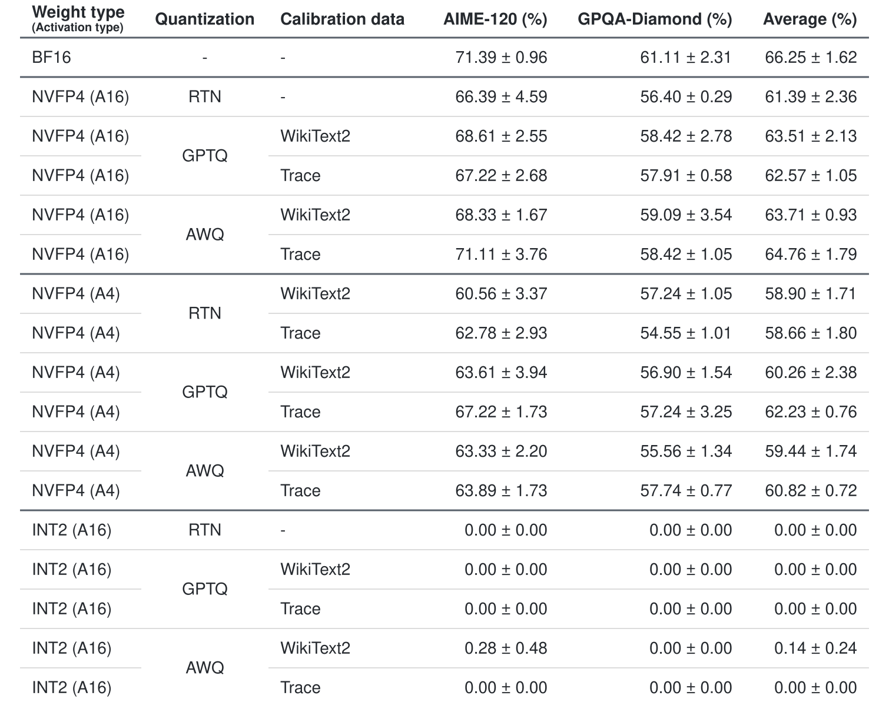
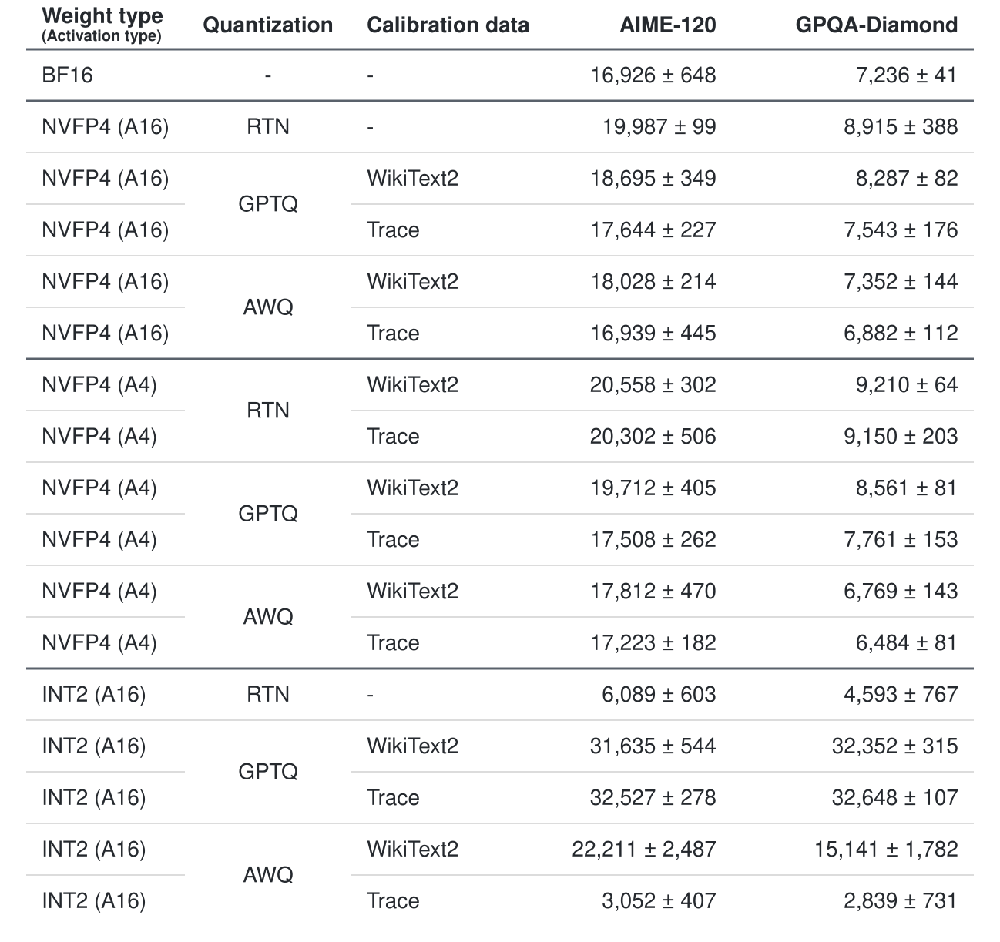
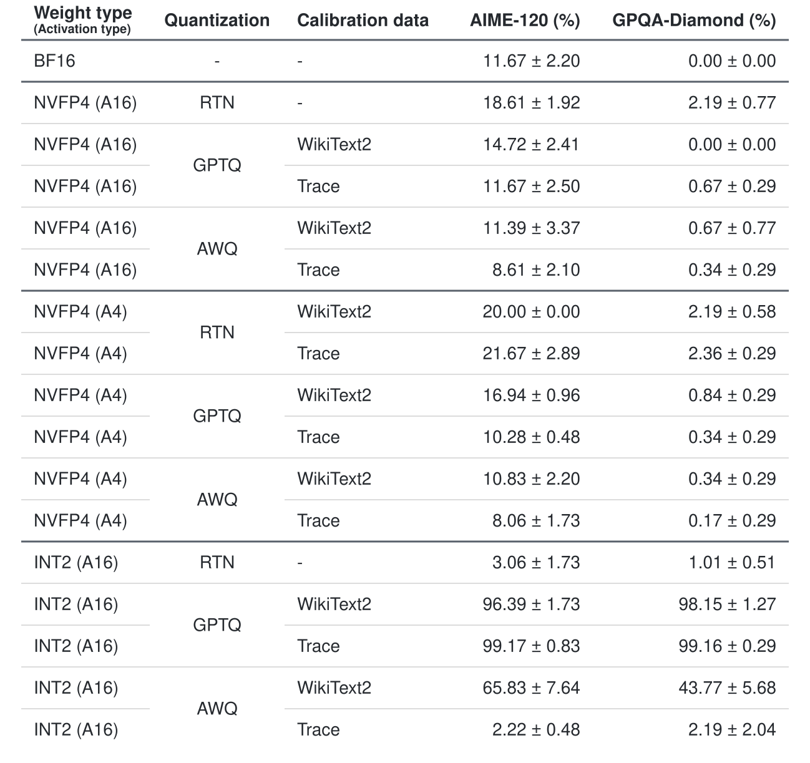
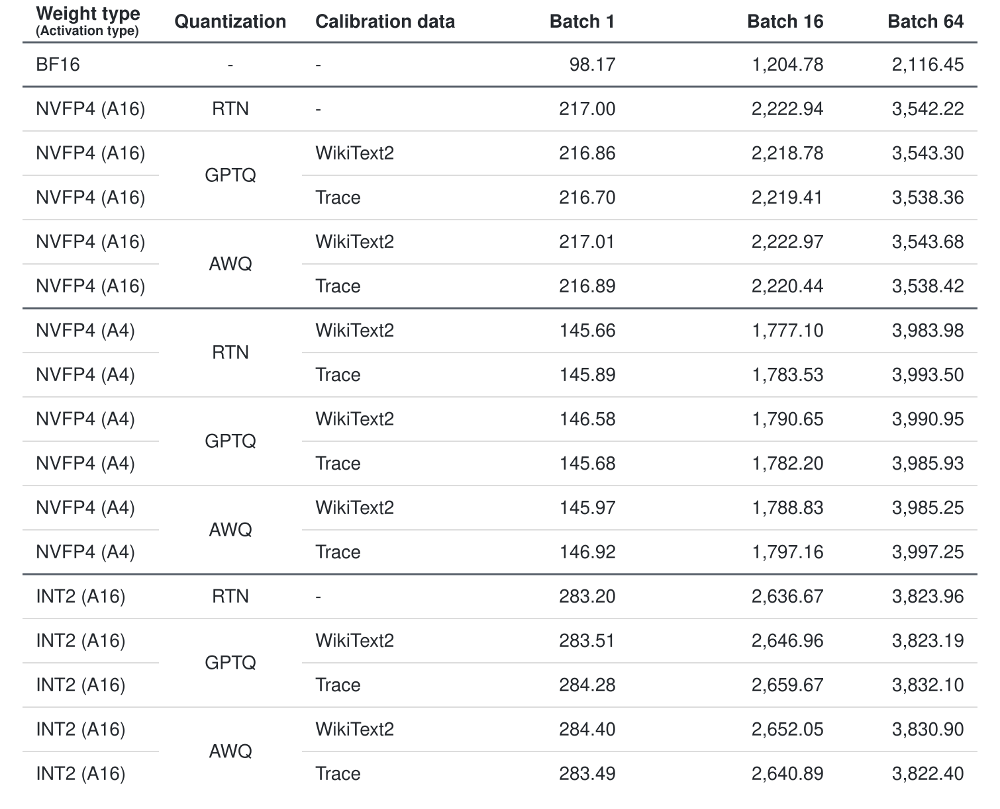
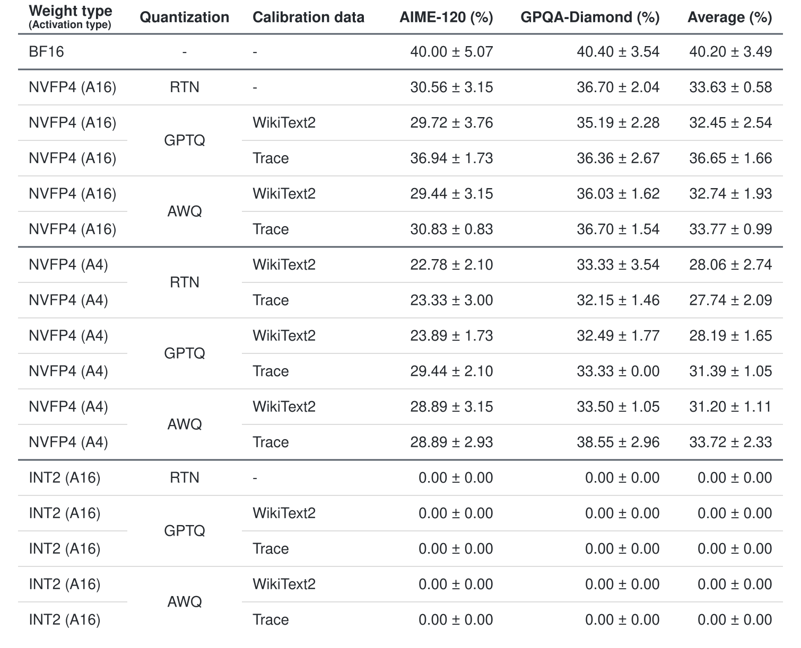
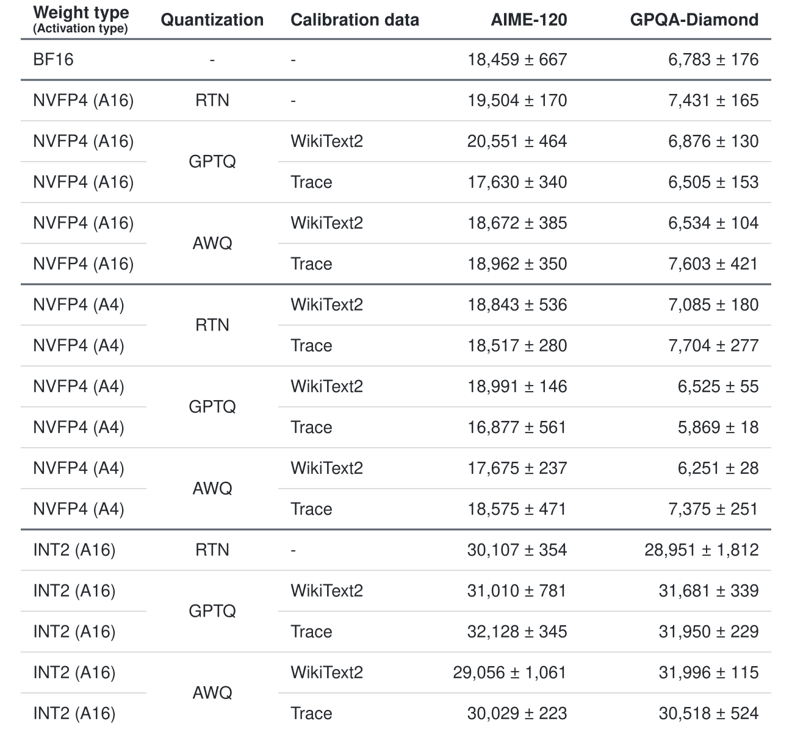
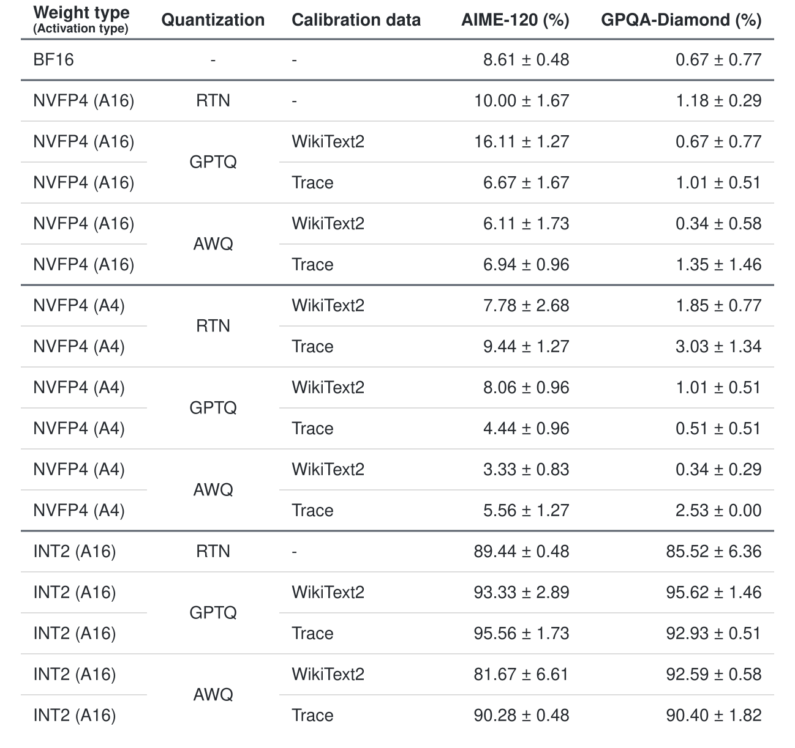
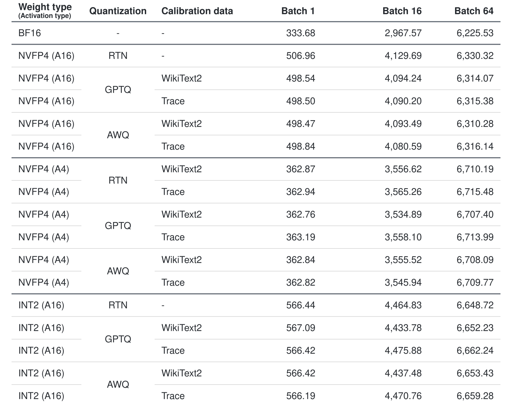

# lowbit-reasoning-ptq

LLM의 weight와 activation 데이터 타입에 따른 reasoning 태스크의 정확도 차이를 비교했다. 비교 항목은 다음과 같다.

1. Weight type 변경: Activation을 BF16(16bit)으로 고정하고, weight를 NVFP4와 INT2로 양자화해 정확도를 비교했다.
2. Activation 데이터 타입 변경: Weight type을 NVFP4로 고정하고, activation을 BF16(16bit)으로 유지하는 경우와 FP4(4bit)로 양자화하는 경우의 정확도를 비교했다.

## 실험에 사용한 모델과 벤치마크

### 모델

[Qwen3-1.7B](https://huggingface.co/Qwen/Qwen3-1.7B)와 [Qwen3-8B](https://huggingface.co/Qwen/Qwen3-8B)를 RTN, [GPTQ](https://arxiv.org/pdf/2210.17323), [AWQ](https://arxiv.org/pdf/2306.00978)로 양자화했다. 양자화 모델과 비교하기 위해 각 모델의 BF16 정확도도 측정했다. Weight에는 BF16, NVFP4, INT2를 사용했고, activation에는 BF16(16bit, 표에서 A16으로 표기)과 FP4(4bit, 표에서 A4로 표기)를 사용했다. Calibration data로는 [WikiText2](https://huggingface.co/datasets/Salesforce/wikitext)의 train split과 각 BF16 모델이 [NuminaMath-1.5](https://huggingface.co/datasets/project-numina/NuminaMath-1.5)의 문제를 풀며 생성한 reasoning trace를 사용했다.

> Reasoning trace로 calibration 샘플을 만들 때는 문제 프롬프트와 BF16 모델이 생성한 응답을 함께 사용했다.

제작 과정은 다음과 같다.

1. 각 calibration data의 텍스트를 이어 붙인 뒤 토큰화한다.
2. 무작위 시작점에서 연속된 2,048토큰을 잘라내는 과정을 반복해 데이터별로 샘플 128개를 만든다.
   1. 샘플링 seed는 0으로 고정했다.

### 벤치마크와 측정 지표

AIME-120([AIME90](https://huggingface.co/datasets/xiaoyuanliu/AIME90) + [AIME 2025](https://huggingface.co/datasets/yentinglin/aime_2025))과 [GPQA-Diamond](https://huggingface.co/datasets/Idavidrein/gpqa)의 전체 데이터를 평가에 사용했다. 두 벤치마크는 각각 120문항과 198문항으로 구성된다. seed를 0, 1, 2로 바꿔 각각 응답을 생성하고 평가했으며, 평가에 사용한 지표는 아래와 같다.

- 정확도: 전체 문항 중 정답을 맞힌 비율이다. 세 seed의 정확도를 평균 ± 표본표준편차(std, ddof=1)로 표시했다.
- 출력 길이: 풀이 과정과 최종 답변을 포함해 생성한 응답의 토큰 수다. 오답과 길이 제한으로 중단된 응답도 포함해 seed별 평균 출력 길이를 구하고, 세 seed의 평균 ± 표본표준편차(std, ddof=1)로 표시했다.
- 최대 출력 길이에 도달한 비율: 길이 제한으로 생성이 중단된 응답의 비율이다. 코드에서는 `finish_reason="length"`로 판별하므로, 출력 상한 `max_tokens=32768`뿐 아니라 입력과 출력을 합친 context 길이 제한에 먼저 도달한 응답도 포함한다. 이 응답은 오답으로 처리했다. seed별 비율을 구하고, 세 seed의 평균 ± 표본표준편차(std, ddof=1)로 표시했다.
- 처리량: 배치 단위로 주어진 입력을 처리할 때 1초당 생성된 토큰 수다.

#### 처리량 측정 설정

BF16과 양자화 모델을 같은 GPU에서 동일한 설정으로 측정했다. 입력 길이는 512토큰, 출력 길이는 2,048토큰으로 고정하고 배치 크기 1, 16, 64를 사용했다. 각 조건에서 세 번 측정한 시간의 중앙값으로 처리량을 계산했다. 측정 시간에는 prefill도 포함했다. 이 설정은 처리량 측정에만 적용했으며, 벤치마크 평가에는 각 문항의 프롬프트를 사용했다.

### 실험 환경 및 설정

| 작업 | Qwen3-1.7B | Qwen3-8B |
|---|---|---|
| 양자화 및 벤치마크 평가 | RTX 5090 | RTX 5090, RTX PRO 4500 Blackwell |
| 처리량 측정 | RTX 5090 | RTX 5090 |

> 벤치마크 평가: 정확도, 출력 길이, 최대 출력 길이에 도달한 비율을 측정, 처리량 측정: 각 모델의 BF16과 양자화 모델을 측정.

- 평가 패키지: vLLM 0.32.0, PyTorch 2.13.0. 모델별 버전 기록은 `reports/`의 `environment.json`에 있다.
- CUDA: 12.8

#### 인퍼런스 세팅

- Thinking 모드: 활성화
- Sampling: temperature 0.6, top-p 0.95, top-k 비활성화
- KV cache dtype: BF16

#### 양자화 설정

양자화 대상에서 임베딩, norm, `lm_head`를 제외했다. Weight-only RTN은 calibration이 필요하지 않아 데이터별로 나누지 않았다. 표에서는 해당 RTN 행의 Calibration data를 `-`로 표시했다. AWQ의 출력 cache 호환성 패치 적용 여부는 체크포인트 메타데이터에 기록했다.

> NVFP4 (A4)의 RTN은 activation을 FP4로 양자화하는 데 필요한 global scale을 calibration data로 정한다. 데이터에 따라 관측되는 activation의 범위와 global scale이 달라질 수 있으므로, WikiText2와 reasoning trace로 각각 calibration한 체크포인트를 만들고 평가했다. 출처: [LLM Compressor 문서](https://docs.vllm.ai/projects/llm-compressor/en/latest/guides/compression_schemes/#nvfp4)

실험에 사용한 프롬프트 및 채점 코드는 `src/benchmarks.py`에 있고, 양자화 설정은 `configs/experiment.yaml`에 있다.

## 실험 결과

실험에 사용한 각 양자화 체크포인트는 문서 하단의 [체크포인트](#체크포인트) 섹션에 있는 Hugging Face 링크에서 다운로드할 수 있다.

### Qwen3-8B 결과

#### 정확도



<details>
<summary>텍스트 표 보기</summary>

| Weight type (Activation type) | Quantization | Calibration data | AIME-120 (%) | GPQA-Diamond (%) | Average (%) |
|---|---|---|---:|---:|---:|
| BF16 | - | - | 71.39 ± 0.96 | 61.11 ± 2.31 | 66.25 ± 1.62 |
| NVFP4 (A16) | RTN | - | 66.39 ± 4.59 | 56.40 ± 0.29 | 61.39 ± 2.36 |
| NVFP4 (A16) | GPTQ | WikiText2 | 68.61 ± 2.55 | 58.42 ± 2.78 | 63.51 ± 2.13 |
| NVFP4 (A16) | GPTQ | Trace | 67.22 ± 2.68 | 57.91 ± 0.58 | 62.57 ± 1.05 |
| NVFP4 (A16) | AWQ | WikiText2 | 68.33 ± 1.67 | 59.09 ± 3.54 | 63.71 ± 0.93 |
| NVFP4 (A16) | AWQ | Trace | 71.11 ± 3.76 | 58.42 ± 1.05 | 64.76 ± 1.79 |
| NVFP4 (A4) | RTN | WikiText2 | 60.56 ± 3.37 | 57.24 ± 1.05 | 58.90 ± 1.71 |
| NVFP4 (A4) | RTN | Trace | 62.78 ± 2.93 | 54.55 ± 1.01 | 58.66 ± 1.80 |
| NVFP4 (A4) | GPTQ | WikiText2 | 63.61 ± 3.94 | 56.90 ± 1.54 | 60.26 ± 2.38 |
| NVFP4 (A4) | GPTQ | Trace | 67.22 ± 1.73 | 57.24 ± 3.25 | 62.23 ± 0.76 |
| NVFP4 (A4) | AWQ | WikiText2 | 63.33 ± 2.20 | 55.56 ± 1.34 | 59.44 ± 1.74 |
| NVFP4 (A4) | AWQ | Trace | 63.89 ± 1.73 | 57.74 ± 0.77 | 60.82 ± 0.72 |
| INT2 (A16) | RTN | - | 0.00 ± 0.00 | 0.00 ± 0.00 | 0.00 ± 0.00 |
| INT2 (A16) | GPTQ | WikiText2 | 0.00 ± 0.00 | 0.00 ± 0.00 | 0.00 ± 0.00 |
| INT2 (A16) | GPTQ | Trace | 0.00 ± 0.00 | 0.00 ± 0.00 | 0.00 ± 0.00 |
| INT2 (A16) | AWQ | WikiText2 | 0.28 ± 0.48 | 0.00 ± 0.00 | 0.14 ± 0.24 |
| INT2 (A16) | AWQ | Trace | 0.00 ± 0.00 | 0.00 ± 0.00 | 0.00 ± 0.00 |

</details>

seed별 두 벤치마크 정확도의 평균 및 표준편차를 구해서 Average에 표시했다. [seed별 평가 결과](reports/qwen3-8b/seed_results.json)

#### 출력 길이

평균 출력 토큰 수와 seed 간 표준편차를 표시했다. 오답과 길이 제한으로 중단된 응답도 포함했다. [seed별 평가 결과](reports/qwen3-8b/seed_results.json)



<details>
<summary>텍스트 표 보기</summary>

| Weight type (Activation type) | Quantization | Calibration data | AIME-120 (tokens) | GPQA-Diamond (tokens) |
|---|---|---|---:|---:|
| BF16 | - | - | 16,926 ± 648 | 7,236 ± 41 |
| NVFP4 (A16) | RTN | - | 19,987 ± 99 | 8,915 ± 388 |
| NVFP4 (A16) | GPTQ | WikiText2 | 18,695 ± 349 | 8,287 ± 82 |
| NVFP4 (A16) | GPTQ | Trace | 17,644 ± 227 | 7,543 ± 176 |
| NVFP4 (A16) | AWQ | WikiText2 | 18,028 ± 214 | 7,352 ± 144 |
| NVFP4 (A16) | AWQ | Trace | 16,939 ± 445 | 6,882 ± 112 |
| NVFP4 (A4) | RTN | WikiText2 | 20,558 ± 302 | 9,210 ± 64 |
| NVFP4 (A4) | RTN | Trace | 20,302 ± 506 | 9,150 ± 203 |
| NVFP4 (A4) | GPTQ | WikiText2 | 19,712 ± 405 | 8,561 ± 81 |
| NVFP4 (A4) | GPTQ | Trace | 17,508 ± 262 | 7,761 ± 153 |
| NVFP4 (A4) | AWQ | WikiText2 | 17,812 ± 470 | 6,769 ± 143 |
| NVFP4 (A4) | AWQ | Trace | 17,223 ± 182 | 6,484 ± 81 |
| INT2 (A16) | RTN | - | 6,089 ± 603 | 4,593 ± 767 |
| INT2 (A16) | GPTQ | WikiText2 | 31,635 ± 544 | 32,352 ± 315 |
| INT2 (A16) | GPTQ | Trace | 32,527 ± 278 | 32,648 ± 107 |
| INT2 (A16) | AWQ | WikiText2 | 22,211 ± 2,487 | 15,141 ± 1,782 |
| INT2 (A16) | AWQ | Trace | 3,052 ± 407 | 2,839 ± 731 |

</details>

#### 최대 출력 길이에 도달한 비율

답변 길이 제한이나 컨텍스트 길이 제한으로 중단된 응답의 비율이다. seed별 비율의 평균과 표준편차를 표시했다. [seed별 평가 결과](reports/qwen3-8b/seed_results.json), [응답별 평가 기록](reports/qwen3-8b/per_problem_metrics.csv)



<details>
<summary>텍스트 표 보기</summary>

| Weight type (Activation type) | Quantization | Calibration data | AIME-120 (%) | GPQA-Diamond (%) |
|---|---|---|---:|---:|
| BF16 | - | - | 11.67 ± 2.20 | 0.00 ± 0.00 |
| NVFP4 (A16) | RTN | - | 18.61 ± 1.92 | 2.19 ± 0.77 |
| NVFP4 (A16) | GPTQ | WikiText2 | 14.72 ± 2.41 | 0.00 ± 0.00 |
| NVFP4 (A16) | GPTQ | Trace | 11.67 ± 2.50 | 0.67 ± 0.29 |
| NVFP4 (A16) | AWQ | WikiText2 | 11.39 ± 3.37 | 0.67 ± 0.77 |
| NVFP4 (A16) | AWQ | Trace | 8.61 ± 2.10 | 0.34 ± 0.29 |
| NVFP4 (A4) | RTN | WikiText2 | 20.00 ± 0.00 | 2.19 ± 0.58 |
| NVFP4 (A4) | RTN | Trace | 21.67 ± 2.89 | 2.36 ± 0.29 |
| NVFP4 (A4) | GPTQ | WikiText2 | 16.94 ± 0.96 | 0.84 ± 0.29 |
| NVFP4 (A4) | GPTQ | Trace | 10.28 ± 0.48 | 0.34 ± 0.29 |
| NVFP4 (A4) | AWQ | WikiText2 | 10.83 ± 2.20 | 0.34 ± 0.29 |
| NVFP4 (A4) | AWQ | Trace | 8.06 ± 1.73 | 0.17 ± 0.29 |
| INT2 (A16) | RTN | - | 3.06 ± 1.73 | 1.01 ± 0.51 |
| INT2 (A16) | GPTQ | WikiText2 | 96.39 ± 1.73 | 98.15 ± 1.27 |
| INT2 (A16) | GPTQ | Trace | 99.17 ± 0.83 | 99.16 ± 0.29 |
| INT2 (A16) | AWQ | WikiText2 | 65.83 ± 7.64 | 43.77 ± 5.68 |
| INT2 (A16) | AWQ | Trace | 2.22 ± 0.48 | 2.19 ± 2.04 |

</details>

#### 처리량

배치 단위로 주어진 입력을 처리할 때 1초당 생성된 토큰 수다. RTX 5090에서 입력 512토큰, 출력 2,048토큰으로 측정했다. 실행 시간에는 prefill을 포함했으며, 각 배치 크기에서 세 번 측정한 시간의 중앙값을 사용했다. [처리량 결과](reports/qwen3-8b/speed.csv)



<details>
<summary>텍스트 표 보기</summary>

| Weight type (Activation type) | Quantization | Calibration data | 배치 크기 1 | 배치 크기 16 | 배치 크기 64 |
|---|---|---|---:|---:|---:|
| BF16 | - | - | 98.17 | 1,204.78 | 2,116.45 |
| NVFP4 (A16) | RTN | - | 217.00 | 2,222.94 | 3,542.22 |
| NVFP4 (A16) | GPTQ | WikiText2 | 216.86 | 2,218.78 | 3,543.30 |
| NVFP4 (A16) | GPTQ | Trace | 216.70 | 2,219.41 | 3,538.36 |
| NVFP4 (A16) | AWQ | WikiText2 | 217.01 | 2,222.97 | 3,543.68 |
| NVFP4 (A16) | AWQ | Trace | 216.89 | 2,220.44 | 3,538.42 |
| NVFP4 (A4) | RTN | WikiText2 | 145.66 | 1,777.10 | 3,983.98 |
| NVFP4 (A4) | RTN | Trace | 145.89 | 1,783.53 | 3,993.50 |
| NVFP4 (A4) | GPTQ | WikiText2 | 146.58 | 1,790.65 | 3,990.95 |
| NVFP4 (A4) | GPTQ | Trace | 145.68 | 1,782.20 | 3,985.93 |
| NVFP4 (A4) | AWQ | WikiText2 | 145.97 | 1,788.83 | 3,985.25 |
| NVFP4 (A4) | AWQ | Trace | 146.92 | 1,797.16 | 3,997.25 |
| INT2 (A16) | RTN | - | 283.20 | 2,636.67 | 3,823.96 |
| INT2 (A16) | GPTQ | WikiText2 | 283.51 | 2,646.96 | 3,823.19 |
| INT2 (A16) | GPTQ | Trace | 284.28 | 2,659.67 | 3,832.10 |
| INT2 (A16) | AWQ | WikiText2 | 284.40 | 2,652.05 | 3,830.90 |
| INT2 (A16) | AWQ | Trace | 283.49 | 2,640.89 | 3,822.40 |

</details>

### Qwen3-1.7B 결과

#### 정확도



<details>
<summary>텍스트 표 보기</summary>

| Weight type (Activation type) | Quantization | Calibration data | AIME-120 (%) | GPQA-Diamond (%) | Average (%) |
|---|---|---|---:|---:|---:|
| BF16 | - | - | 40.00 ± 5.07 | 40.40 ± 3.54 | 40.20 ± 3.49 |
| NVFP4 (A16) | RTN | - | 30.56 ± 3.15 | 36.70 ± 2.04 | 33.63 ± 0.58 |
| NVFP4 (A16) | GPTQ | WikiText2 | 29.72 ± 3.76 | 35.19 ± 2.28 | 32.45 ± 2.54 |
| NVFP4 (A16) | GPTQ | Trace | 36.94 ± 1.73 | 36.36 ± 2.67 | 36.65 ± 1.66 |
| NVFP4 (A16) | AWQ | WikiText2 | 29.44 ± 3.15 | 36.03 ± 1.62 | 32.74 ± 1.93 |
| NVFP4 (A16) | AWQ | Trace | 30.83 ± 0.83 | 36.70 ± 1.54 | 33.77 ± 0.99 |
| NVFP4 (A4) | RTN | WikiText2 | 22.78 ± 2.10 | 33.33 ± 3.54 | 28.06 ± 2.74 |
| NVFP4 (A4) | RTN | Trace | 23.33 ± 3.00 | 32.15 ± 1.46 | 27.74 ± 2.09 |
| NVFP4 (A4) | GPTQ | WikiText2 | 23.89 ± 1.73 | 32.49 ± 1.77 | 28.19 ± 1.65 |
| NVFP4 (A4) | GPTQ | Trace | 29.44 ± 2.10 | 33.33 ± 0.00 | 31.39 ± 1.05 |
| NVFP4 (A4) | AWQ | WikiText2 | 28.89 ± 3.15 | 33.50 ± 1.05 | 31.20 ± 1.11 |
| NVFP4 (A4) | AWQ | Trace | 28.89 ± 2.93 | 38.55 ± 2.96 | 33.72 ± 2.33 |
| INT2 (A16) | RTN | - | 0.00 ± 0.00 | 0.00 ± 0.00 | 0.00 ± 0.00 |
| INT2 (A16) | GPTQ | WikiText2 | 0.00 ± 0.00 | 0.00 ± 0.00 | 0.00 ± 0.00 |
| INT2 (A16) | GPTQ | Trace | 0.00 ± 0.00 | 0.00 ± 0.00 | 0.00 ± 0.00 |
| INT2 (A16) | AWQ | WikiText2 | 0.00 ± 0.00 | 0.00 ± 0.00 | 0.00 ± 0.00 |
| INT2 (A16) | AWQ | Trace | 0.00 ± 0.00 | 0.00 ± 0.00 | 0.00 ± 0.00 |

</details>

seed별 두 벤치마크 정확도의 평균 및 표준편차를 구해서 Average에 표시했다. [seed별 평가 결과](reports/qwen3-1.7b/seed_results.json)

#### 출력 길이

평균 출력 토큰 수와 seed 간 표준편차를 표시했다. 오답과 길이 제한으로 중단된 응답도 포함했다. [seed별 평가 결과](reports/qwen3-1.7b/seed_results.json)



<details>
<summary>텍스트 표 보기</summary>

| Weight type (Activation type) | Quantization | Calibration data | AIME-120 (tokens) | GPQA-Diamond (tokens) |
|---|---|---|---:|---:|
| BF16 | - | - | 18,459 ± 667 | 6,783 ± 176 |
| NVFP4 (A16) | RTN | - | 19,504 ± 170 | 7,431 ± 165 |
| NVFP4 (A16) | GPTQ | WikiText2 | 20,551 ± 464 | 6,876 ± 130 |
| NVFP4 (A16) | GPTQ | Trace | 17,630 ± 340 | 6,505 ± 153 |
| NVFP4 (A16) | AWQ | WikiText2 | 18,672 ± 385 | 6,534 ± 104 |
| NVFP4 (A16) | AWQ | Trace | 18,962 ± 350 | 7,603 ± 421 |
| NVFP4 (A4) | RTN | WikiText2 | 18,843 ± 536 | 7,085 ± 180 |
| NVFP4 (A4) | RTN | Trace | 18,517 ± 280 | 7,704 ± 277 |
| NVFP4 (A4) | GPTQ | WikiText2 | 18,991 ± 146 | 6,525 ± 55 |
| NVFP4 (A4) | GPTQ | Trace | 16,877 ± 561 | 5,869 ± 18 |
| NVFP4 (A4) | AWQ | WikiText2 | 17,675 ± 237 | 6,251 ± 28 |
| NVFP4 (A4) | AWQ | Trace | 18,575 ± 471 | 7,375 ± 251 |
| INT2 (A16) | RTN | - | 30,107 ± 354 | 28,951 ± 1,812 |
| INT2 (A16) | GPTQ | WikiText2 | 31,010 ± 781 | 31,681 ± 339 |
| INT2 (A16) | GPTQ | Trace | 32,128 ± 345 | 31,950 ± 229 |
| INT2 (A16) | AWQ | WikiText2 | 29,056 ± 1,061 | 31,996 ± 115 |
| INT2 (A16) | AWQ | Trace | 30,029 ± 223 | 30,518 ± 524 |

</details>

#### 최대 출력 길이에 도달한 비율

답변 길이 제한이나 컨텍스트 길이 제한으로 중단된 응답의 비율이다. seed별 비율의 평균과 표준편차를 표시했다. [seed별 평가 결과](reports/qwen3-1.7b/seed_results.json), [응답별 평가 기록](reports/qwen3-1.7b/per_problem_metrics.csv)



<details>
<summary>텍스트 표 보기</summary>

| Weight type (Activation type) | Quantization | Calibration data | AIME-120 (%) | GPQA-Diamond (%) |
|---|---|---|---:|---:|
| BF16 | - | - | 8.61 ± 0.48 | 0.67 ± 0.77 |
| NVFP4 (A16) | RTN | - | 10.00 ± 1.67 | 1.18 ± 0.29 |
| NVFP4 (A16) | GPTQ | WikiText2 | 16.11 ± 1.27 | 0.67 ± 0.77 |
| NVFP4 (A16) | GPTQ | Trace | 6.67 ± 1.67 | 1.01 ± 0.51 |
| NVFP4 (A16) | AWQ | WikiText2 | 6.11 ± 1.73 | 0.34 ± 0.58 |
| NVFP4 (A16) | AWQ | Trace | 6.94 ± 0.96 | 1.35 ± 1.46 |
| NVFP4 (A4) | RTN | WikiText2 | 7.78 ± 2.68 | 1.85 ± 0.77 |
| NVFP4 (A4) | RTN | Trace | 9.44 ± 1.27 | 3.03 ± 1.34 |
| NVFP4 (A4) | GPTQ | WikiText2 | 8.06 ± 0.96 | 1.01 ± 0.51 |
| NVFP4 (A4) | GPTQ | Trace | 4.44 ± 0.96 | 0.51 ± 0.51 |
| NVFP4 (A4) | AWQ | WikiText2 | 3.33 ± 0.83 | 0.34 ± 0.29 |
| NVFP4 (A4) | AWQ | Trace | 5.56 ± 1.27 | 2.53 ± 0.00 |
| INT2 (A16) | RTN | - | 89.44 ± 0.48 | 85.52 ± 6.36 |
| INT2 (A16) | GPTQ | WikiText2 | 93.33 ± 2.89 | 95.62 ± 1.46 |
| INT2 (A16) | GPTQ | Trace | 95.56 ± 1.73 | 92.93 ± 0.51 |
| INT2 (A16) | AWQ | WikiText2 | 81.67 ± 6.61 | 92.59 ± 0.58 |
| INT2 (A16) | AWQ | Trace | 90.28 ± 0.48 | 90.40 ± 1.82 |

</details>

#### 처리량

배치 단위로 주어진 입력을 처리할 때 1초당 생성된 토큰 수다. RTX 5090에서 입력 512토큰, 출력 2,048토큰으로 측정했다. 실행 시간에는 prefill을 포함했으며, 각 배치 크기에서 세 번 측정한 시간의 중앙값을 사용했다. [처리량 결과](reports/qwen3-1.7b/speed.csv)



<details>
<summary>텍스트 표 보기</summary>

| Weight type (Activation type) | Quantization | Calibration data | 배치 크기 1 | 배치 크기 16 | 배치 크기 64 |
|---|---|---|---:|---:|---:|
| BF16 | - | - | 333.68 | 2,967.57 | 6,225.53 |
| NVFP4 (A16) | RTN | - | 506.96 | 4,129.69 | 6,330.32 |
| NVFP4 (A16) | GPTQ | WikiText2 | 498.54 | 4,094.24 | 6,314.07 |
| NVFP4 (A16) | GPTQ | Trace | 498.50 | 4,090.20 | 6,315.38 |
| NVFP4 (A16) | AWQ | WikiText2 | 498.47 | 4,093.49 | 6,310.28 |
| NVFP4 (A16) | AWQ | Trace | 498.84 | 4,080.59 | 6,316.14 |
| NVFP4 (A4) | RTN | WikiText2 | 362.87 | 3,556.62 | 6,710.19 |
| NVFP4 (A4) | RTN | Trace | 362.94 | 3,565.26 | 6,715.48 |
| NVFP4 (A4) | GPTQ | WikiText2 | 362.76 | 3,534.89 | 6,707.40 |
| NVFP4 (A4) | GPTQ | Trace | 363.19 | 3,558.10 | 6,713.99 |
| NVFP4 (A4) | AWQ | WikiText2 | 362.84 | 3,555.52 | 6,708.09 |
| NVFP4 (A4) | AWQ | Trace | 362.82 | 3,545.94 | 6,709.77 |
| INT2 (A16) | RTN | - | 566.44 | 4,464.83 | 6,648.72 |
| INT2 (A16) | GPTQ | WikiText2 | 567.09 | 4,433.78 | 6,652.23 |
| INT2 (A16) | GPTQ | Trace | 566.42 | 4,475.88 | 6,662.24 |
| INT2 (A16) | AWQ | WikiText2 | 566.42 | 4,437.48 | 6,653.43 |
| INT2 (A16) | AWQ | Trace | 566.19 | 4,470.76 | 6,659.28 |

</details>

## 실험 결과 분석

### Weight type 변경에 따른 분석

#### Qwen3-8B

NVFP4 (A16)의 평균 정확도는 AIME-120에서 66.39\~71.11%, GPQA-Diamond에서 56.40\~59.09%였으며, BF16 대비 각각 0.28\~5.00 pp, 2.02\~4.71 pp 낮았다. AIME-120에서는 AWQ + Trace가 71.11%로 BF16보다 0.28 pp 낮았지만, 같은 설정의 GPQA-Diamond 정확도는 58.42%로 BF16보다 2.69 pp 낮았다. INT2 (A16)은 AIME-120의 AWQ + WikiText2에서만 0.28%였고, 나머지 설정과 GPQA-Diamond 전체에서는 0%였다. [8B 평가 결과](reports/qwen3-8b/main_table.csv)

NVFP4 (A16)의 AIME-120 평균 출력 길이는 16,939\~19,987토큰으로, BF16의 16,926토큰과 비슷하거나 길었다. INT2 (A16)은 알고리즘에 따라 출력 길이와 길이 제한으로 중단된 비율이 달랐다. GPTQ는 AIME-120에서 96.39\~99.17%, GPQA-Diamond에서 98.15\~99.16%가 길이 제한으로 중단됐다. 반면 AWQ + Trace의 평균 출력 길이는 각각 3,052토큰과 2,839토큰이었고, 길이 제한으로 중단된 비율도 2.22%와 2.19%로 낮았다. 이 설정의 정확도는 두 벤치마크 모두 0%여서, 출력이 짧아진 것을 문제 풀이의 효율이 높아진 결과로 해석하기는 어렵다. [8B seed별 평가 결과](reports/qwen3-8b/seed_results.json)

처리량은 배치 크기 1, 16, 64에서 모두 INT2 (A16), NVFP4 (A16), BF16 순으로 높았다. 같은 알고리즘과 calibration 조건에서 INT2 (A16)은 NVFP4 (A16)보다 배치 크기 1에서 30.5\~31.2%, 16에서 18.6\~19.8%, 64에서 7.9\~8.3% 높았다. 배치 크기가 커질수록 두 weight type의 처리량 차이는 줄었다. INT2는 처리량이 높았지만, 정확도는 두 벤치마크 모두 거의 0%였다. [8B 처리량 결과](reports/qwen3-8b/speed.csv)

#### Qwen3-1.7B

NVFP4 (A16)의 평균 정확도는 AIME-120에서 29.44\~36.94%, GPQA-Diamond에서 35.19\~36.70%였으며, BF16 대비 각각 3.06\~10.56 pp, 3.70\~5.22 pp 낮았다. NVFP4 (A16) 중 AIME-120 정확도가 가장 높은 설정은 GPTQ + Trace의 36.94%였다. INT2 (A16)은 두 태스크의 모든 설정에서 0%였다. INT2 정확도 저하의 원인은 저장된 짧은 reference 및 kernel 진단만으로 특정하지 못했다. [1.7B 평가 결과](reports/qwen3-1.7b/main_table.csv)

NVFP4 (A16)의 평균 출력 길이는 AIME-120에서 17,630\~20,551토큰, GPQA-Diamond에서 6,505\~7,603토큰이었다. INT2 (A16)은 두 벤치마크 모두 약 29,000\~32,000토큰으로 길었고, 길이 제한으로 중단된 비율도 AIME-120에서 81.67\~95.56%, GPQA-Diamond에서 85.52\~95.62%였다. 8B의 INT2에서는 RTN과 AWQ + Trace가 짧게 출력을 마친 것과 달리, 1.7B에서는 모든 알고리즘에서 대부분의 응답이 길이 제한으로 중단됐다. [1.7B seed별 평가 결과](reports/qwen3-1.7b/seed_results.json)

처리량은 8B와 마찬가지로 모든 배치 크기에서 INT2 (A16), NVFP4 (A16), BF16 순으로 높았다. 같은 알고리즘과 calibration 조건에서 INT2 (A16)은 NVFP4 (A16)보다 배치 크기 1에서 11.7\~13.8%, 16에서 8.1\~9.6%, 64에서 5.0\~5.5% 높았다. NVFP4 (A16)의 BF16 대비 처리량은 배치 크기 1에서 1.49\~1.52배였지만, 64에서는 1.01\~1.02배로 차이가 작았다. [1.7B 처리량 결과](reports/qwen3-1.7b/speed.csv)

### Activation data type 변경에 따른 분석

#### Qwen3-8B

AIME-120에서는 GPTQ + Trace가 A16과 A4 모두 67.22%였고, 나머지 다섯 비교는 A4에서 평균 정확도가 3.61\~7.22 pp 낮았다. AWQ + Trace는 71.11%에서 63.89%로 7.22 pp 낮아졌다. GPQA-Diamond에서는 RTN + WikiText2가 56.40%에서 57.24%로 0.84 pp 높아졌고, 나머지 다섯 비교는 0.67\~3.54 pp 낮아졌다. [8B 설정별 비교](reports/qwen3-8b/factor_effects.csv)

A16을 A4로 바꿨을 때 출력 길이와 길이 제한으로 중단된 비율의 변화 방향은 설정에 따라 달랐다. AIME-120의 GPTQ + WikiText2는 평균 출력 길이가 18,695토큰에서 19,712토큰으로 길어졌고, 길이 제한으로 중단된 비율도 14.72%에서 16.94%로 높아졌다. 반면 GPTQ + Trace는 17,644토큰에서 17,508토큰으로 짧아졌고, 길이 제한으로 중단된 비율도 11.67%에서 10.28%로 낮아졌다. GPQA-Diamond에서는 RTN과 GPTQ의 평균 출력 길이가 2.64\~3.32% 길어졌지만, AWQ는 5.79\~7.92% 짧아졌다. 다만 AWQ + WikiText2는 A16과 A4를 서로 다른 GPU에서 평가했으므로, 이 차이를 activation type만의 영향으로 단정하기 어렵다. [8B seed별 평가 결과](reports/qwen3-8b/seed_results.json)

처리량은 모든 알고리즘과 calibration 조건에서 배치 크기에 따라 증감 방향이 같았다. A4는 A16보다 배치 크기 1에서 32.3\~32.9%, 16에서 19.1\~20.1% 낮았지만, 64에서는 12.5\~13.0% 높았다. Activation 비트 수를 줄였을 때 처리량이 높아지는 결과는 배치 크기 64에서만 나타났다. [8B 처리량 결과](reports/qwen3-8b/speed.csv)

#### Qwen3-1.7B

AIME-120에서 A16 대비 A4의 평균 정확도는 RTN과 GPTQ에서 5.83\~7.78 pp, AWQ에서 0.56\~1.94 pp 낮았다. GPTQ + Trace는 A16의 36.94%에서 A4의 29.44%로 7.50 pp 낮아져, 같은 비교에서 평균이 유지된 8B와 다른 결과를 보였다. 반대로 AWQ + Trace의 감소폭은 1.94 pp로 8B의 7.22 pp보다 작았다. GPQA-Diamond에서는 AWQ + Trace가 36.70%에서 38.55%로 1.85 pp 높아졌고, 나머지 다섯 비교는 2.53\~4.55 pp 낮아졌다. [1.7B 설정별 비교](reports/qwen3-1.7b/factor_effects.csv)

AIME-120에서는 A16을 A4로 바꾼 여섯 비교 모두 평균 출력 길이가 2.04\~7.59% 짧아졌고, 길이 제한으로 중단된 비율도 0.56\~8.06 pp 낮아졌다. 다만 정확도도 모두 낮아졌으므로, 출력 길이와 중단 비율의 감소를 문제 풀이 성능의 개선으로 볼 수는 없다. GPQA-Diamond에서는 여섯 비교 중 다섯 개의 평균 출력 길이가 짧아졌지만, 길이 제한으로 중단된 비율은 네 비교에서 높아졌다. 평균 출력 길이가 줄어드는 경향이 길이 제한으로 중단되는 응답의 감소로 이어지지는 않았다. [1.7B seed별 평가 결과](reports/qwen3-1.7b/seed_results.json)

처리량은 8B와 같은 방향이었다. A4는 A16보다 배치 크기 1에서 27.1\~28.4%, 16에서 13.0\~13.9% 낮았지만, 64에서는 6.0\~6.3% 높았다. 두 모델 모두 측정한 세 배치 크기 중 64에서만 A4의 처리량이 A16보다 높았다. [1.7B 처리량 결과](reports/qwen3-1.7b/speed.csv)

### Calibration data 변경에 따른 분석

#### Qwen3-8B

AIME-120에서 WikiText2 대신 Trace를 사용했을 때 NVFP4 (A4)의 평균 정확도는 RTN, GPTQ, AWQ에서 각각 2.22 pp, 3.61 pp, 0.56 pp 높았다. NVFP4 (A16)에서는 GPTQ가 1.39 pp 낮았고, AWQ가 2.78 pp 높았다. GPQA-Diamond에서는 NVFP4 (A4)의 GPTQ와 AWQ가 각각 0.34 pp, 2.19 pp 높았지만, RTN은 2.69 pp 낮았다. NVFP4 (A16)은 GPTQ와 AWQ 모두 0.51\~0.67 pp 낮아, Trace를 사용했을 때 정확도가 높아지는 경향이 모든 설정에서 나타나지는 않았다. INT2 (A16)의 GPTQ와 AWQ는 AIME-120의 AWQ + WikiText2에서만 0.28%였고, 나머지 설정과 GPQA-Diamond 전체에서는 0%였다. [8B 설정별 비교](reports/qwen3-8b/factor_effects.csv)

NVFP4의 GPTQ와 AWQ는 A16과 A4, 두 벤치마크 모두 Trace를 사용했을 때 평균 출력 길이가 3.30\~11.18% 짧아졌다. AIME-120에서 길이 제한으로 중단된 비율도 네 비교 모두 2.78\~6.67 pp 낮아졌다. GPQA-Diamond에서는 NVFP4 (A16)의 GPTQ가 평균 출력 길이는 짧아졌는데도 길이 제한으로 중단된 비율은 0%에서 0.67%로 높아졌다. INT2 (A16)의 AWQ는 AIME-120에서 WikiText2 대신 Trace를 사용했을 때 평균 출력 길이가 22,211토큰에서 3,052토큰으로, 길이 제한으로 중단된 비율은 65.83%에서 2.22%로 낮아졌지만, 정확도는 각각 0.28%와 0%였다. 다만 NVFP4 (A16)의 AWQ는 두 calibration data를 서로 다른 GPU에서 평가했으므로, 출력 길이 차이를 calibration data만의 영향으로 단정하기 어렵다. [8B seed별 평가 결과](reports/qwen3-8b/seed_results.json)

같은 weight와 activation type, 알고리즘, 배치 크기에서 두 calibration data의 처리량 차이는 WikiText2 대비 0.66% 이내였고, 증감 방향도 설정에 따라 달랐다. 고정된 출력 길이로 측정한 처리량에서는 calibration data에 따른 차이가 작았다. [8B 처리량 결과](reports/qwen3-8b/speed.csv)

#### Qwen3-1.7B

AIME-120에서 GPTQ는 WikiText2 대신 Trace를 사용했을 때 NVFP4 (A16)의 평균 정확도가 29.72%에서 36.94%로 7.22 pp 높았다. NVFP4 (A4)에서도 23.89%에서 29.44%로 5.56 pp 높았다. AWQ는 NVFP4 (A16)에서 1.39 pp 높았고, NVFP4 (A4)에서는 두 calibration data 모두 28.89%였다. GPQA-Diamond에서는 NVFP4 (A4)의 AWQ가 33.50%에서 38.55%로 5.05 pp 높았지만, 같은 포맷의 RTN은 33.33%에서 32.15%로 1.18 pp 낮았다. INT2 (A16)의 GPTQ와 AWQ는 두 벤치마크에서 WikiText2와 Trace 모두 0%였다. [1.7B 설정별 비교](reports/qwen3-1.7b/factor_effects.csv)

NVFP4의 GPTQ는 A16과 A4, 두 벤치마크 모두 Trace를 사용했을 때 평균 출력 길이가 5.40\~14.21% 짧아졌다. AIME-120에서는 길이 제한으로 중단된 비율도 A16에서 9.44 pp, A4에서 3.61 pp 낮아져, 정확도가 높아지면서 출력 길이와 중단 비율이 함께 줄었다. 반면 AWQ는 Trace를 사용했을 때 평균 출력 길이가 네 비교 모두 1.55\~17.97% 길어졌고, 길이 제한으로 중단된 비율도 0.83\~2.22 pp 높아졌다. 8B의 NVFP4 AWQ에서 Trace를 사용했을 때 출력이 짧아진 것과 달리, 1.7B에서는 길어졌다. [1.7B seed별 평가 결과](reports/qwen3-1.7b/seed_results.json)

같은 weight와 activation type, 알고리즘, 배치 크기에서 두 calibration data의 처리량 차이는 WikiText2 대비 0.95% 이내였다. 8B와 마찬가지로 고정 길이의 처리량 차이는 작았으며, GPTQ와 AWQ에서 관찰한 출력 길이의 변화와는 구분해야 한다. 이 처리량은 벤치마크 응답의 실제 풀이 시간을 측정한 값은 아니다. [1.7B 처리량 결과](reports/qwen3-1.7b/speed.csv)

## 결론

이번 실험에서 INT2 (A16)은 높은 토큰 생성 처리량에도 불구하고 두 모델의 정확도가 거의 0%여서, 평가한 문제를 푸는 용도로 사용하기 어려웠다. NVFP4 (A16)은 BF16보다 처리량이 높았지만 정확도 손실이 있었고, 그 차이는 모델과 설정에 따라 달랐다. 특히 1.7B의 배치 크기 64에서는 BF16과 처리량이 거의 같아, 정확도를 낮추면서 얻는 처리량 이득이 작았다. 따라서 weight 양자화의 이점은 비트 수나 토큰 생성 처리량만으로 판단하기보다, 목표 태스크의 정확도와 사용할 배치 크기를 함께 고려해야 한다.

Activation을 A4로 낮추는 것이 항상 빠른 선택은 아니었다. 두 모델 모두 측정한 배치 크기 1과 16에서는 A16보다 처리량이 낮았고, 64에서만 높았다. 정확도도 대부분의 설정에서 낮아졌으므로, 작은 배치에서 처리량을 높이려는 목적으로 A4를 선택할 근거는 부족했다. 배치 크기 64에서는 처리량 개선과 정확도 손실을 함께 비교해야 한다. 출력이 짧아지거나 길이 제한으로 중단된 비율이 낮아졌더라도 정확도가 함께 낮아졌다면, 이를 문제 풀이의 효율이 높아진 결과로 볼 수는 없다.

Calibration data의 효과도 모델과 알고리즘을 구분해서 봐야 한다. 1.7B의 NVFP4 GPTQ는 AIME-120에서 Trace를 사용했을 때 정확도가 높아지면서 출력 길이와 길이 제한으로 중단된 비율이 함께 줄었다. 반면 같은 모델의 NVFP4 AWQ는 Trace를 사용했을 때 출력 길이와 길이 제한으로 중단된 비율이 모두 늘었다. 고정 길이로 측정한 처리량 차이는 두 모델 모두 작았으므로, calibration data를 선택할 때는 토큰 생성 처리량보다 정확도와 응답 길이의 변화를 중심으로 비교하는 것이 적절하다. Reasoning trace가 모든 설정에서 더 나은 calibration data였다고 결론 내릴 수는 없다.

## 한계점

### GPU

8B의 벤치마크 평가에는 RTX 5090과 RTX PRO 4500 Blackwell에서 생성한 결과가 포함돼 있다. GPU 변경의 영향을 별도로 분리해 측정하지 않았으므로, 작은 점수 차이를 양자화 설정만의 영향으로 단정하기 어렵다.

### 실험에 사용한 모델

Qwen3의 두 모델 크기만 평가했으므로 다른 모델 계열이나 크기에서도 같은 경향이 나타나는지는 확인하지 않았다.

### 양자화 설정

NVFP4 (A16)과 INT2 (A16)은 데이터 타입, 비트 수, group 크기, scale 방식이 함께 달라지므로, 어느 한 요소만의 영향을 분리한 비교는 아니다.

## 저장된 결과

모델별 평가 결과, 처리량 원본 측정값, INT2 진단 결과와 실험 설정은 `reports/`에 있다. 각 파일의 내용과 열의 의미, 정확도 차이의 뺄셈 방향은 [평가 결과 파일 안내](reports/README.md)에 정리했다.

## 서버 환경 및 실행 방법

### 서버 환경

CUDA를 사용할 수 있는 Linux GPU 서버에서 실행한다. NVFP4 (A4)의 activation을 FP4로 처리하기 위해 Blackwell GPU 사용을 권장한다. Python 3.12를 사용했으며, 양자화용 `venv_quant`와 평가 및 처리량 측정용 `venv_serve`를 별도로 구성해 실험에 사용했다. [지원 GPU 안내](https://docs.vllm.ai/projects/llm-compressor/en/latest/steps/choosing-scheme/)

### 실행 방법

저장소를 내려받은 뒤 저장소 루트로 이동한다.

```bash
git clone https://github.com/minguinho26/lowbit-reasoning-ptq.git
cd lowbit-reasoning-ptq
```

아래 명령어로 가상환경을 만들고 필요한 패키지를 설치한다. `WS`는 모델과 실험 결과를 저장할 디렉터리 경로다.

> GPQA-Diamond를 사용하려면 Hugging Face에서 이용 동의를 완료해야 한다. 아래 HF 인증 단계에서는 동의한 계정으로 로그인해야 서버에서 데이터셋을 다운로드할 수 있다. [HF 인증 안내](https://huggingface.co/docs/huggingface_hub/en/guides/cli)

```bash
export WS="$HOME/lowbit-reasoning-ptq-workspace"
export HF_HOME="$WS/hf_cache"
mkdir -p "$WS"
python3.12 -m venv "$WS/venv_quant"
python3.12 -m venv "$WS/venv_serve"
"$WS/venv_quant/bin/python" -m pip install -r requirements-quant.txt
"$WS/venv_serve/bin/python" -m pip install -r requirements-serve.txt
PY="$WS/venv_serve/bin/python"

# 위에서 지정한 HF_HOME 경로에 인증 정보를 저장
"$WS/venv_serve/bin/hf" auth login

# BF16 모델 다운로드
$PY src/fetch_models.py

# 실험 목록과 실행 계획 확인
$PY src/run_matrix.py list
$PY src/run_matrix.py queue --models qwen3-8b,qwen3-1.7b --dry # 실행할 작업만 표시하며 실제 실험은 수행하지 않음
```

공개한 양자화 체크포인트를 `$WS/models/<실험 이름>/`에 내려받으면, 다시 양자화하지 않고 성능을 측정할 수 있다.

> 실험 이름은 `<model>__<format>[__<algorithm>__<calibration>]` 형식이다. 예를 들어 `qwen3-8b__nvfp4a16__awq__trace`는 Qwen3-8B에 NVFP4 weight, BF16 activation, AWQ, Trace calibration을 사용한 실험이다.

실험을 돌리는 명령어 종류는 아래와 같다.

```bash
# 실험 하나를 seed 하나로 전체 문항 평가
$PY src/evaluate.py --run qwen3-8b__nvfp4a16__awq__trace --bench aime120 --seed 0

# 일부 문항 확인: 전체 평가와 별도 파일에 저장
$PY src/evaluate.py --run qwen3-8b__bf16 --bench aime120 --seed 0 --limit 30

# 저장된 원본 평가 기록 재분석: 추론은 실행하지 않음
$PY src/analyze.py

# 전체 실험 실행: 장시간 실행 가능한 세션 사용
bash queue_main.sh
```

생성된 응답과 문항별 채점 결과는 `$WS/results/eval/<실험 이름>/`에 함께 저장한다. 평가가 끝나면 문항 수와 정확도 등을 `.done.json` 파일에 요약하고, 분석 단계에서 집계한 CSV는 `$WS/results/analysis/`에 저장한다. 파일명과 저장 경로의 예시는 다음과 같다.

```text
$WS/results/
├── eval/
│   ├── qwen3-8b__nvfp4a16__awq__trace/
│   │   ├── aime120__s0.jsonl          # 생성 응답과 문항별 채점 결과
│   │   └── aime120__s0.done.json      # 전체 문항의 평가 요약
│   └── qwen3-8b__bf16/
│       └── aime120__s0.limit30.jsonl  # --limit 30으로 평가한 결과
└── analysis/
    ├── main_table.csv                # 실험별 평가 요약
    ├── factor_effects.csv            # 설정 간 정확도 차이
    └── speed.csv                     # 처리량 요약
```

전체 실험은 양자화, 평가, INT2 진단, 처리량 측정, 분석 순서로 실행한다.

## 체크포인트
실험에 사용한 양자화 체크포인트의 다운로드 링크는 아래와 같다.

### Qwen3-8B

#### NVFP4 (A16)

| Quantization method | Calibration data | Link |
|---|---|---|
| RTN | - | [Hugging Face](https://huggingface.co/Minguinho-zeze/Qwen3-8B-NVFP4A16-RTN) |
| GPTQ | WikiText2 | [Hugging Face](https://huggingface.co/Minguinho-zeze/Qwen3-8B-NVFP4A16-GPTQ-WikiText2) |
| GPTQ | Trace | [Hugging Face](https://huggingface.co/Minguinho-zeze/Qwen3-8B-NVFP4A16-GPTQ-Trace) |
| AWQ | WikiText2 | [Hugging Face](https://huggingface.co/Minguinho-zeze/Qwen3-8B-NVFP4A16-AWQ-WikiText2) |
| AWQ | Trace | [Hugging Face](https://huggingface.co/Minguinho-zeze/Qwen3-8B-NVFP4A16-AWQ-Trace) |

#### NVFP4 (A4)

| Quantization method | Calibration data | Link |
|---|---|---|
| RTN | WikiText2 | [Hugging Face](https://huggingface.co/Minguinho-zeze/Qwen3-8B-NVFP4-RTN-WikiText2) |
| RTN | Trace | [Hugging Face](https://huggingface.co/Minguinho-zeze/Qwen3-8B-NVFP4-RTN-Trace) |
| GPTQ | WikiText2 | [Hugging Face](https://huggingface.co/Minguinho-zeze/Qwen3-8B-NVFP4-GPTQ-WikiText2) |
| GPTQ | Trace | [Hugging Face](https://huggingface.co/Minguinho-zeze/Qwen3-8B-NVFP4-GPTQ-Trace) |
| AWQ | WikiText2 | [Hugging Face](https://huggingface.co/Minguinho-zeze/Qwen3-8B-NVFP4-AWQ-WikiText2) |
| AWQ | Trace | [Hugging Face](https://huggingface.co/Minguinho-zeze/Qwen3-8B-NVFP4-AWQ-Trace) |

#### INT2 (A16)

| Quantization method | Calibration data | Link |
|---|---|---|
| RTN | - | [Hugging Face](https://huggingface.co/Minguinho-zeze/Qwen3-8B-W2A16-RTN) |
| GPTQ | WikiText2 | [Hugging Face](https://huggingface.co/Minguinho-zeze/Qwen3-8B-W2A16-GPTQ-WikiText2) |
| GPTQ | Trace | [Hugging Face](https://huggingface.co/Minguinho-zeze/Qwen3-8B-W2A16-GPTQ-Trace) |
| AWQ | WikiText2 | [Hugging Face](https://huggingface.co/Minguinho-zeze/Qwen3-8B-W2A16-AWQ-WikiText2) |
| AWQ | Trace | [Hugging Face](https://huggingface.co/Minguinho-zeze/Qwen3-8B-W2A16-AWQ-Trace) |

### Qwen3-1.7B

#### NVFP4 (A16)

| Quantization method | Calibration data | Link |
|---|---|---|
| RTN | - | [Hugging Face](https://huggingface.co/Minguinho-zeze/Qwen3-1.7B-NVFP4A16-RTN) |
| GPTQ | WikiText2 | [Hugging Face](https://huggingface.co/Minguinho-zeze/Qwen3-1.7B-NVFP4A16-GPTQ-WikiText2) |
| GPTQ | Trace | [Hugging Face](https://huggingface.co/Minguinho-zeze/Qwen3-1.7B-NVFP4A16-GPTQ-Trace) |
| AWQ | WikiText2 | [Hugging Face](https://huggingface.co/Minguinho-zeze/Qwen3-1.7B-NVFP4A16-AWQ-WikiText2) |
| AWQ | Trace | [Hugging Face](https://huggingface.co/Minguinho-zeze/Qwen3-1.7B-NVFP4A16-AWQ-Trace) |

#### NVFP4 (A4)

| Quantization method | Calibration data | Link |
|---|---|---|
| RTN | WikiText2 | [Hugging Face](https://huggingface.co/Minguinho-zeze/Qwen3-1.7B-NVFP4-RTN-WikiText2) |
| RTN | Trace | [Hugging Face](https://huggingface.co/Minguinho-zeze/Qwen3-1.7B-NVFP4-RTN-Trace) |
| GPTQ | WikiText2 | [Hugging Face](https://huggingface.co/Minguinho-zeze/Qwen3-1.7B-NVFP4-GPTQ-WikiText2) |
| GPTQ | Trace | [Hugging Face](https://huggingface.co/Minguinho-zeze/Qwen3-1.7B-NVFP4-GPTQ-Trace) |
| AWQ | WikiText2 | [Hugging Face](https://huggingface.co/Minguinho-zeze/Qwen3-1.7B-NVFP4-AWQ-WikiText2) |
| AWQ | Trace | [Hugging Face](https://huggingface.co/Minguinho-zeze/Qwen3-1.7B-NVFP4-AWQ-Trace) |

#### INT2 (A16)

| Quantization method | Calibration data | Link |
|---|---|---|
| RTN | - | [Hugging Face](https://huggingface.co/Minguinho-zeze/Qwen3-1.7B-W2A16-RTN) |
| GPTQ | WikiText2 | [Hugging Face](https://huggingface.co/Minguinho-zeze/Qwen3-1.7B-W2A16-GPTQ-WikiText2) |
| GPTQ | Trace | [Hugging Face](https://huggingface.co/Minguinho-zeze/Qwen3-1.7B-W2A16-GPTQ-Trace) |
| AWQ | WikiText2 | [Hugging Face](https://huggingface.co/Minguinho-zeze/Qwen3-1.7B-W2A16-AWQ-WikiText2) |
| AWQ | Trace | [Hugging Face](https://huggingface.co/Minguinho-zeze/Qwen3-1.7B-W2A16-AWQ-Trace) |
